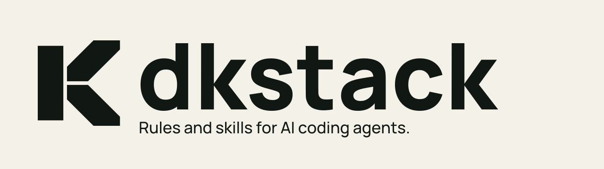

# dkstack

Rules and skills for AI coding agents, in one place.

<picture>
  <source media="(prefers-color-scheme: dark)" srcset="assets/brand/header-dark.svg">
  
</picture>

[](https://github.com/daniel-kindl/dkstack/releases/latest)
[](LICENSE)
[](https://github.com/daniel-kindl/dkstack/actions/workflows/validate.yml?query=branch%3Amain+event%3Apush)

**Use the same coding standards across your projects.**
dkstack gives any team shared rules and task-specific skills for AI coding agents.
Your project's `AGENTS.md` links your agent to the relevant guidance.
It is guidance only, with no service to run.

[Get started](#start) · [Browse skills](skills/index.md) · [Explore the rules](#what-is-in-each-section) · [Get help](#get-help)

## Start

In your project, give your coding agent this prompt:

```text
Set up dkstack in this repository.
Read and follow:
https://raw.githubusercontent.com/daniel-kindl/dkstack/v1/skills/setup-dkstack/SKILL.md
```

The [setup skill](skills/setup-dkstack/SKILL.md) links your project's `AGENTS.md` to dkstack and configures your agent to read it.
It preserves project text unless you approve a conflicting rule change.
It commits the setup on a branch and asks before installing skills.
If your repository lacks commit, version, and quality rules, setup continues with [bootstrap](skills/bootstrap/SKILL.md).

**Check the setup:** start a new agent session.
Ask, "Which skill will you read first for a task? Open it."
It should open [triage](skills/triage/SKILL.md).

<details>
<summary>Set up manually</summary>

1. Copy [sample-AGENTS.md](sample-AGENTS.md) into a new `AGENTS.md`, or merge it into your existing file.
2. Keep your project facts and record approved rule exceptions in that file.
3. Configure your agent to read `AGENTS.md`, if needed. For Claude Code, add `@AGENTS.md` to `CLAUDE.md`.

For other clients, see step 5 in the [setup instructions](skills/setup-dkstack/SKILL.md#steps).
Then check the setup in a new session as described above.

</details>

## How to use

Give your agent a task in your project.
The [triage skill](skills/triage/SKILL.md) selects the rules and skills for that task.
Rules set the standards. Skills give the agent steps to follow.

| Your task | Skill |
| --- | --- |
| Plan a feature before writing code. | [plan-work](skills/plan-work/SKILL.md) |
| Implement a change with tests. | [tdd-loop](skills/tdd-loop/SKILL.md) |
| Review a pull request. | [code-review](skills/code-review/SKILL.md) |
| Check an interface for accessibility. | [ui-review](skills/ui-review/SKILL.md) |
| Set up repository checks and versioning. | [bootstrap](skills/bootstrap/SKILL.md) |

[Browse all skills](skills/index.md) for architecture, writing, learning, and other tasks.
Keep project facts and approved rule exceptions in your project's `AGENTS.md`.
See [how project rules work with dkstack](AGENTS.md#precedence).

## Install the skills

Skill installation is optional. The setup above lets your agent read the shared guidance directly.
Install skills so your agent can find them in its local skill folder.
These copies still link to dkstack's rule pages.

The [skills CLI](https://github.com/vercel-labs/skills#install-a-skill) requires Node.js 22.20 or later.
From your project directory, install `triage`:

```bash
npx skills add https://github.com/daniel-kindl/dkstack/tree/v1 --skill triage
```

Replace `triage` with another name from the [skills list](skills/index.md).
To see available skills before installing:

```bash
npx skills add https://github.com/daniel-kindl/dkstack/tree/v1 --list
```

Installed skills do not update by themselves.
For skills installed from `v1`, run `npx skills update` after a release.

## Release status

Read the [latest release notes](https://github.com/daniel-kindl/dkstack/releases/latest) or the full [changelog](CHANGELOG.md).
The setup uses `v1`, the branch for compatible releases.
The `main` branch contains work that is not released yet.

## Follow versions

Choose the version in the dkstack entry URL in your project's `AGENTS.md`.

| What you need | What to use |
| --- | --- |
| Compatible updates as they are released. | Keep `v1` in your dkstack URL. |
| A fixed version, or a return to a known good release. | Replace `v1` with a published `vX.Y.Z` tag. |
| The next major version. | Read its changelog and migration steps before changing the URL. |

When you pin a tag, your agent must read all dkstack files from that tag.
Follow the [version rule](AGENTS.md#version).
If you installed skills, install them again with that same tag in place of `v1` in the install command.
Changing the entry URL does not update local skill copies.

The documentation calls a repository whose `AGENTS.md` points to dkstack a **consumer**.
See [how consumers follow versions](docs/adr/0001-how-consumers-follow-versions.md) for the release model.

## What is in each section

| Find guidance for | Read |
| --- | --- |
| Agent instructions and project rules. | [AGENTS.md](AGENTS.md) |
| Design decisions and code. | [Architecture](architecture/index.md) · [Coding](coding/index.md) |
| Tests and interfaces. | [Test-driven development](tdd/index.md) · [UI and accessibility](ui/index.md) |
| Commits, reviews, and releases. | [Version control](version-control/index.md) · [Workflow](workflow/index.md) · [Versioning](versioning/index.md) |
| Clear text and learning. | [Writing](writing/index.md) · [Learning](learning/index.md) |
| Task instructions and practical advice. | [Skills](skills/index.md) · [Tips](tips/index.md) |

## Checks

The [validate workflow](.github/workflows/validate.yml) checks changes to this repository.
It checks links, skill structure, writing, workflow configuration, changelog entries, and tests.
The badge above links to validation results for pushes to `main`.

<details>
<summary>Run the checks as a contributor</summary>

Use Node 24 or later. From a clone of dkstack, run:

```bash
npm run check
```

The pull request title, body, breaking-change, and actionlint checks are not part of this command.
See [Run the checks](CONTRIBUTING.md#run-the-checks) for the full procedure.

The changelog check confirms that CHANGELOG.md has an entry for the version in `package.json`.
The validation workflow does not publish. Only the release job uses the release app secrets.

</details>

## Get help

[Open an issue](https://github.com/daniel-kindl/dkstack/issues) for a question, a problem, or a proposed change.
Include your agent, dkstack version, and what you expected to happen.
Report security concerns through the [security policy](SECURITY.md).

## Changes

To contribute, start with an issue and the [contribution guide](CONTRIBUTING.md).
Daniel Kindl ([@daniel-kindl](https://github.com/daniel-kindl)) owns dkstack and approves each change.
Propose shared rule changes here instead of editing dkstack from another project.

## Visual identity

[Use the logos, icons, and banners](assets/brand/README.md).
The asset guide lists colors, typography, and usage instructions.

## License

[MIT](LICENSE). The [asset guide](assets/brand/README.md#license-and-sources) records the font license and artwork sources.
