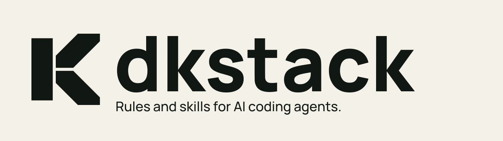
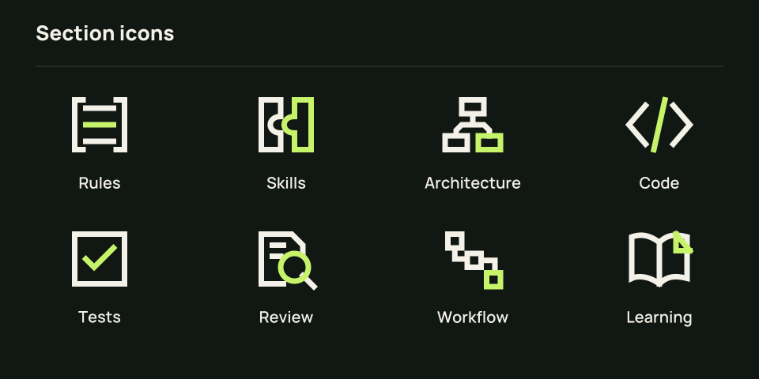
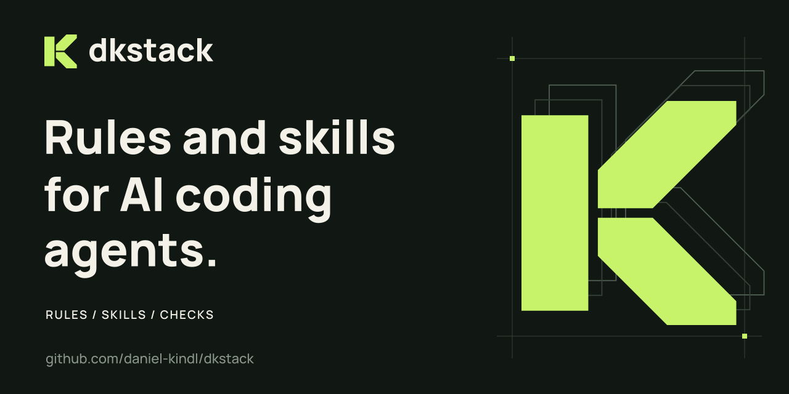

# Brand assets

The dkstack identity combines a three-part K with the name dkstack in lowercase letters.
The name beside the K is the wordmark.
The parts represent skills that work alone or together.

<picture>
  <source media="(prefers-color-scheme: dark)" srcset="header-dark.svg">
  
</picture>

## Logos and marks

Logos and standalone marks have transparent backgrounds.
The SVG files contain editable paths. They need no font download, script, or external image.

| Asset | Use |
| --- | --- |
| [Dark logo](logo-dark.svg) | Lime mark and chalk wordmark on a dark surface. |
| [Light logo](logo-light.svg) | Graphite mark and wordmark on a light surface. |
| [One-color logo](logo-mono.svg) | Chalk mark and wordmark on a dark surface. |
| [Lime mark](mark.svg) | Mark alone on graphite. |
| [Graphite mark](mark-graphite.svg) | Mark alone on chalk or white. |
| [Chalk mark](mark-chalk.svg) | Mark alone on graphite. |
| [Favicon](favicon.svg) | Lime mark on a graphite square. |
| [Dark header](header-dark.svg) | README header on a graphite background, 1280 by 360. |
| [Light header](header-light.svg) | README header on a chalk background, 1280 by 360. |
| [Social banner](banner.svg) | Banner on graphite, 1280 by 640. |

Keep the K's proportions and the gaps between its three parts.
Leave clear space around each logo equal to the width of the K's vertical part.
Use the mark alone when the full logo would be less than 180 px wide.
Display standalone mark files at least 16 px high. Prefer 32 px or more.

## Icons

The eight icons share a 24-unit grid and a 2-unit stroke.
Each file adds 4 units of padding inside a 32-unit graphite tile.
The tile keeps the chalk and lime strokes visible on light and dark pages.

| Icon | File |
| --- | --- |
| Rules | [rules.svg](icons/rules.svg) |
| Skills | [skills.svg](icons/skills.svg) |
| Architecture | [architecture.svg](icons/architecture.svg) |
| Code | [code.svg](icons/code.svg) |
| Tests | [tests.svg](icons/tests.svg) |
| Review | [review.svg](icons/review.svg) |
| Workflow | [workflow.svg](icons/workflow.svg) |
| Learning | [learning.svg](icons/learning.svg) |

Show each icon at 32 px or more. Use text labels for section or action icons.
Use empty alt text for a decorative icon beside that label.
Give an icon-only control an accessible name in the page that uses it.

## Colors

| Color | Hex | Use |
| --- | --- | --- |
| Graphite | `#111814` | Dark surfaces and text on chalk. |
| Chalk | `#F3F1E8` | Light surfaces and text on graphite. |
| Electric lime | `#C7F36B` | Mark and icon accents on graphite. |
| Sage | `#89968C` | Secondary text on graphite. |

Use graphite text on lime. Do not use chalk text on lime or lime text on chalk.
Let status badges use their own result colors.
The checks badge shows the current text and color supplied by Shields.io.

## Type

In the SVG assets, the wordmark and headings use Manrope at weight 800.
Supporting text in these assets uses weights 500 and 600.
All lettering in the SVG assets is outlined, so it renders without an installed font.
Keep normal README text as Markdown so it can reflow and resize.

To change lettering, set new text in Manrope and convert it to paths in a vector editor.
Keep the SVG title and description accurate after a change.
The source font is [Manrope in Google Fonts](https://github.com/google/fonts/tree/main/ofl/manrope).

## Banners

The compact headers fit the README. The larger banner fits a social preview or announcement.

The README selects its header with a picture element and a dark-theme media query.
Its fallback is the light header. Text above the header states the purpose of the project.
Use relative asset paths inside this repository so a branch preview shows that branch's files.

## Badges

The README uses three linked [Shields.io](https://shields.io/) badges.

| Badge | Source | Destination |
| --- | --- | --- |
| Release | Latest published GitHub release, excluding prereleases. | Latest release. |
| License | GitHub license metadata. | Repository license. |
| Checks | The validate workflow, restricted to pushes on main. | Workflow runs on main. |

The badges need a network connection.
Shields.io and GitHub cache badge images, so a badge can show an older value.
The checks badge reports the remote workflow result. It does not report a local check result.

## License and sources

The brand artwork uses the repository's [MIT license](../../LICENSE).
Manrope uses the [SIL Open Font License 1.1](licenses/Manrope-OFL.txt).
The font file is not bundled. The license copy records the source of the outlined lettering.

The mark and icons were redrawn as paths from the concept approved in the owner's chat.
The [identity issue](https://github.com/daniel-kindl/dkstack/issues/381) records that instruction.
The concept images are references, not dependencies of these assets.

Return to the [project README](../../README.md).
