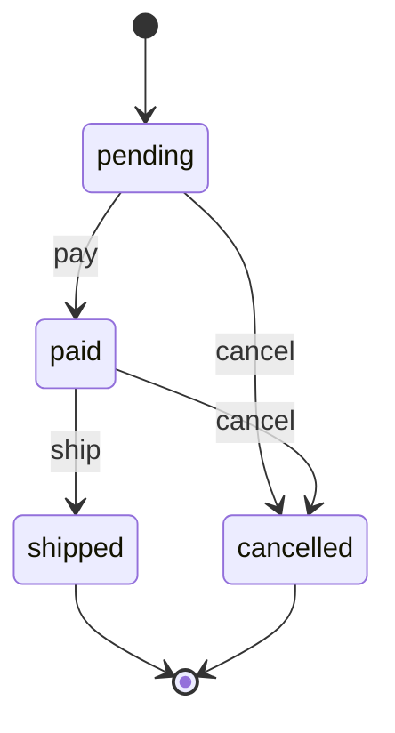

# Make a diagram

Use when a reader must see a structure, an order or a change that the text alone makes hard to
follow.

A diagram adds to the text. It does not replace the text. Read
[writing](https://raw.githubusercontent.com/daniel-kindl/dkstack/v1/writing/index.md) for the
text around it.

## Steps

1. Decide if a diagram helps. See [When to use a diagram](#when-to-use-a-diagram). If it does not help, stop.
2. Select the kind of diagram for the need. See [Kind of diagram](#kind-of-diagram).
3. Select the format. See [Format](#format).
4. Write the diagram. Use the names from the code or the text. Show one idea.
5. Write the text alternative. See [Check](#check).
6. Put the diagram and its text alternative in the place for the target. See [Place](#place).
7. Do the checks in [Check](#check). Fix each problem before you publish the diagram.

## Subagents

If you can start subagents, use one as a new reader in step 7. Do steps 1 to 6 yourself. Then start one subagent that has not seen your source or your context. Give it a brief that is complete without your context:

- The diagram and its text alternative, or their file paths.
- Who the readers are.
- This task: "Say in three sentences what the diagram shows. List each label, arrow or shape that is unclear. Say if the text alternative gives the same idea as the diagram."
- A word limit, for example 200 words.
- This line: "Report to me only. Do not change files, post, approve or merge."

Start each subagent with the setting below. The [subagent guide](https://raw.githubusercontent.com/daniel-kindl/dkstack/v1/workflow/subagents.md) maps each tier to a model.

- New reader: tier medium, effort medium.

Compare the report with the idea from step 4. If the reader found a different idea, fix the diagram. Do the other checks in step 7 yourself.

If you cannot start subagents, do the steps one at a time in the order of this skill.

## When to use a diagram

Use a diagram when the reader must see one of these:

- An order of steps with branches or loops.
- Messages between two or more parts.
- The states of one thing and the events that change them.
- The parts of a system and which part uses which part.
- The entities of a data model and their relations.
- A structure before and after the change.

The text is sufficient when one short paragraph or one list tells the full idea. Do not add a
diagram to a trivial change, for example a typo fix or a one-line rename. Do not add a diagram only
to make the page look complete.

## Kind of diagram

| Need | Shows | Mermaid type |
| --- | --- | --- |
| Flow | Steps, decisions and loops of one process | `flowchart` |
| Sequence | Messages between parts, in time order | `sequenceDiagram` |
| State | The states of one thing and the events that move it | `stateDiagram-v2` |
| Component or dependency | The parts and the direction of each use | `flowchart` |
| Data model | Entities, key fields and relations | `erDiagram` |
| Before and after | The structure before and after the change | Two `flowchart` diagrams, or a plain-text tree or diff |

If two needs apply, make two small diagrams. Do not merge them into one large diagram.

## Format

Use Mermaid in a fenced `mermaid` block in Markdown. The code host renders the diagram from the
text, and a diff shows each change. GitHub and GitLab render a `mermaid` block.

Use a plain-text sketch in a fenced `text` block in these cases:

- The host does not render Mermaid.
- The picture is a file tree, a call tree or a small diff.
- The picture has three nodes or fewer.

Do not commit a binary image of a diagram, for example a PNG or an SVG export. A diff cannot show
what changed in it. A screenshot of a rendered UI is not a diagram. For screenshots, see
[visual verification](https://raw.githubusercontent.com/daniel-kindl/dkstack/v1/ui/visual-verification.md).

Keep the diagram small. If it has more than about 12 nodes, split it.

## Place

| Target | Place |
| --- | --- |
| Pull request body | In Summary, under the text that it explains. See [write-pr](https://raw.githubusercontent.com/daniel-kindl/dkstack/v1/skills/write-pr/SKILL.md). |
| Issue body | Under the goal, or under the steps that show a bug. |
| Spec or plan | Next to the decision or the increment that it shows. See [plan-work](https://raw.githubusercontent.com/daniel-kindl/dkstack/v1/skills/plan-work/SKILL.md). |
| ADR | In Context or in Options considered. Show each option the same way. See [write-adr](https://raw.githubusercontent.com/daniel-kindl/dkstack/v1/skills/write-adr/SKILL.md). |
| Docs page | In the page in the repository, next to the text that it explains. |

Put the text alternative directly above the diagram.

## Check

Before you publish the diagram, check these items:

- The diagram matches the code or the text. Each name in the diagram is a name in the code, the
  text or `CONTEXT.md`. Each arrow is a real call, message, transition or relation. Do not add a
  part that does not exist.
- The diagram renders. Look at the preview on the code host, or run a Mermaid parser if the
  project has one. If you cannot check the render, say so. In a pull request, write it as NOT RUN
  in Evidence.
- The diagram has a text alternative. One or two sentences tell what the diagram shows and the
  main point. A reader who cannot see the render gets the same idea. Examples are an agent that
  reads the raw file and a person with a screen reader. For the rule, see
  [accessibility](https://raw.githubusercontent.com/daniel-kindl/dkstack/v1/ui/accessibility.md).
- The text alternative passes
  [writing-check](https://raw.githubusercontent.com/daniel-kindl/dkstack/v1/skills/writing-check/SKILL.md).

## Good example

A pull request adds a `cancelled` state to an order. The Summary has this text and diagram:

````markdown
An order can now go from `pending` or `paid` to `cancelled`. A `shipped` order cannot be
cancelled.


````

The text alternative comes first and tells the main point. The state names are the names in the
code. The diagram has one idea. The next change to the states shows as a line in the diff.

## Bad example

A pull request adds a `cancelled` state to an order. The Summary has a PNG export of a whiteboard
sketch with 30 boxes. The boxes show the full checkout system. One box has the name "Order Manager",
but the code has no part with that name. The body has no text that tells what changed.

The image is binary, so the next change to it shows no diff. The reader cannot find the new state
among 30 boxes. A name does not match the code. A reader who cannot see the image gets nothing.

## Rules

- Do not require a diagram. A change that the text explains has no diagram.
- Do not invent a part, a call or a relation to complete the picture.
- When the code changes, update the diagram in the same change, or remove it.
